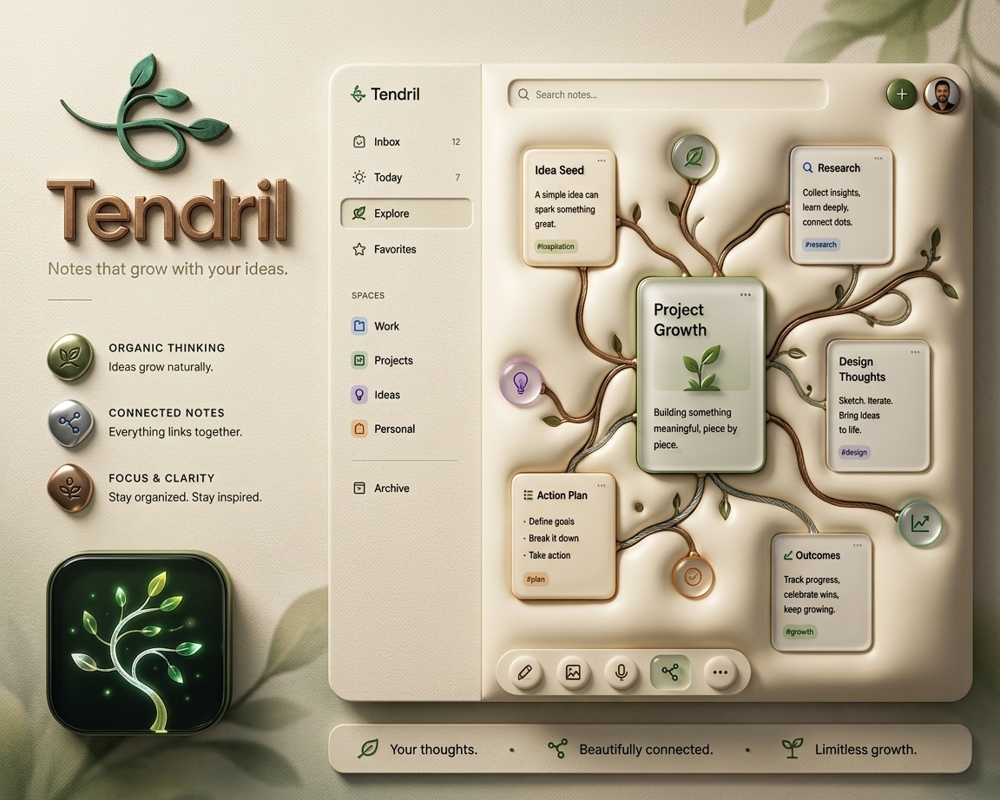
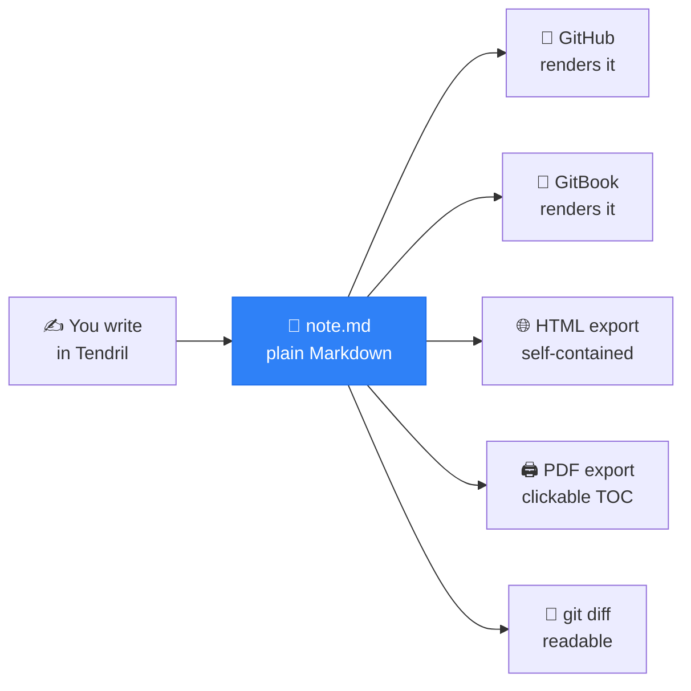
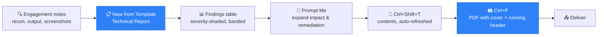
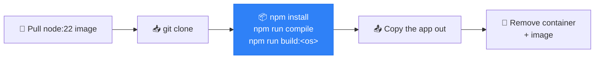
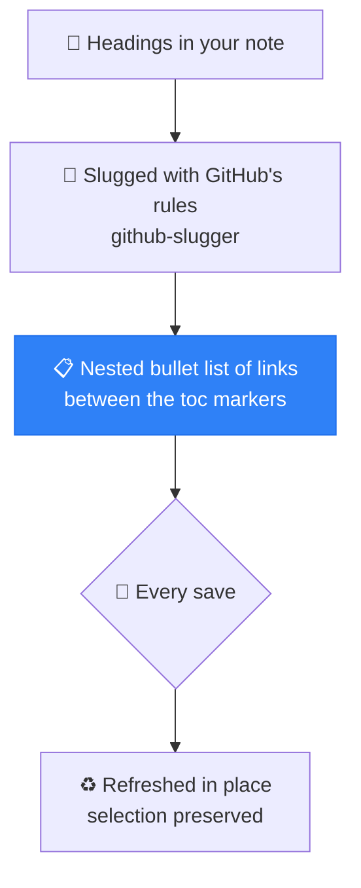
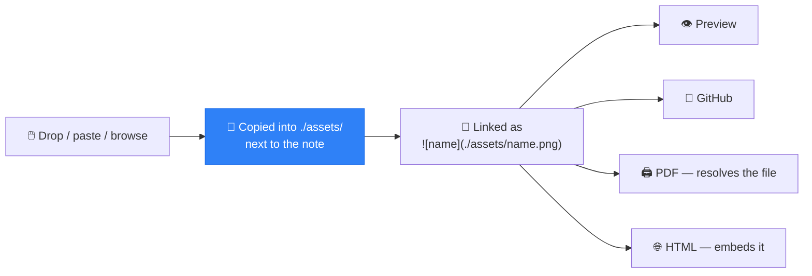
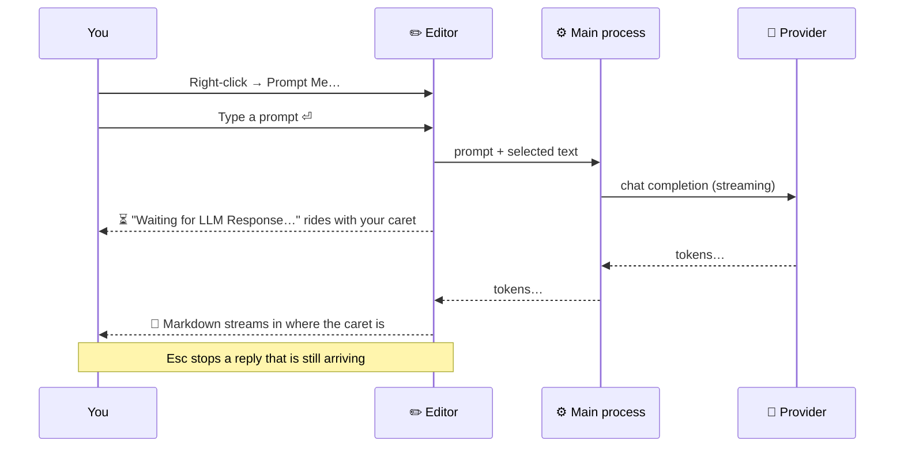
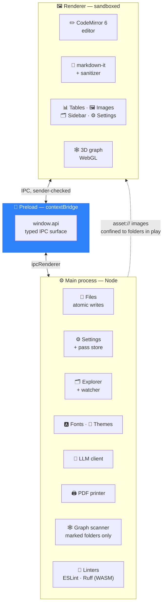
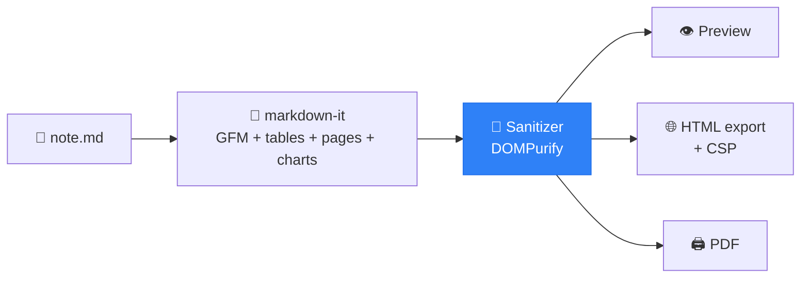

<div align="center">



# 🌿 Tendril

**A minimalist desktop Markdown editor with Word-like structure — that survives as plain text.**

📝 **Microsoft Word's document features + Obsidian's Markdown workflow, in one editor.**
Take notes the way you already do, then turn them into a **delivery-ready pentest report** — cover page,
linked contents, severity-shaded findings tables, running header, clickable PDF — without ever leaving Markdown
or opening Word. 🛡️

[](#-license)
[](#%EF%B8%8F-installation)
[](https://www.electronjs.org/)
[](https://www.typescriptlang.org/)

</div>

---

## 📑 Contents

- [Why Tendril](#-why-tendril)
- [Features](#-features)
- [Built for pentest reports](#%EF%B8%8F-built-for-pentest-reports)
- [Installation](#%EF%B8%8F-installation)
- [Keyboard shortcuts](#%EF%B8%8F-keyboard-shortcuts)
- [The linked table of contents](#-the-linked-table-of-contents)
- [Tables, the Word way](#-tables-the-word-way)
- [3D charts](#-3d-charts)
- [Images](#%EF%B8%8F-images)
- [Explorer](#%EF%B8%8F-explorer)
- [Code & text files](#-code--text-files)
- [Terminal](#-terminal)
- [Remote files over SSH](#-remote-files-over-ssh)
- [Tag graph](#%EF%B8%8F-tag-graph)
- [Prompt Me — optional AI](#-prompt-me--optional-ai)
- [PDF & HTML export](#%EF%B8%8F-pdf--html-export)
- [Appearance](#-appearance)
- [Templates](#-templates)
- [Architecture](#%EF%B8%8F-architecture)
- [Security](#-security)
- [Development](#-development)
- [License](#-license)

---

## 💡 Why Tendril

Word gives you structure — a contents page, shaded table cells, a cover sheet — and locks
it in a binary file. Markdown gives you a plain-text file that lives happily in git, and
takes the structure away.

Tendril refuses the trade. **Everything it adds is written into the `.md` file as Markdown
that other tools already understand:**



The table of contents is a bullet list of links. Table shading is an HTML comment the app
manages for you. The front matter is YAML. Delete Tendril tomorrow and every file you wrote
still opens, still renders, still diffs. 🔓

### 🤝 The best of both worlds

Tendril is a deliberate merge of the features people actually use in each tool:

| 📝 Taken from **MS Word** | 🟣 Taken from **Obsidian** |
|---|---|
| Linked table of contents, refreshed automatically | Plain `.md` files in a plain folder — your vault stays yours |
| Word-style table grid: merge, shading, banded rows, alignment | Live preview that renders as you type |
| Cover page and title block from document properties | Fast file explorer with search |
| Running header / footer and "Page n of m" in the PDF | Community themes — import any Obsidian theme's palette |
| Print-quality export you can hand to a client | Paste a screenshot straight into the note |
| Save As — you decide where every new document goes | Graph view — every note linked to its tags, in 3D |

...and nothing from either that locks the file. ✅

---

## ✨ Features

| | Feature | What it does |
|---|---|---|
| 🔗 | **Linked table of contents** | Written into the file between `<!-- toc -->` markers, refreshed on every save, GitHub-compatible anchors |
| 📊 | **Word-style tables** | Size-picker grid, right-click menu for merge, shading, alignment, banded rows — and it stays a valid GFM table |
| 📈 | **3D bar & pie charts** | Word-style 3D charts from a ` ```chart ` block of YAML — a visual editor with live preview, every colour and angle adjustable, vector in the PDF |
| 🖼️ | **Images** | Drop, paste or browse; copied into an `assets/` folder next to the note and linked relatively |
| 🪟 | **Three views** | Edit, Split and Reading for Markdown notes — with Edit always rendering Markdown in place as you type |
| ✏️ | **Multiple cursors** | Sublime-style: `Ctrl+D`, column carets, split selection into lines |
| 🐍 | **Code & text files** | `.py` and `.js` files highlighted and linted (Ruff, ESLint) with one-click fixes; `.txt`, `.env` and other text files open as plain text ([details](#-code--text-files)) |
| 🌐 | **Remote files over SSH** | A Remote section in the explorer: browse a server, drag to upload, right-click to download — resumable rsync transfers of any size, port forwarding, keys and passwords kept in `pass` ([details](#-remote-files-over-ssh)) |
| 🔑 | **sudo auto-paste** | Saved sudo passwords filled in safely — locally and on servers (secret-marker prompts, one try then stop), `Ctrl+Alt+P` by hand ([details](#-passwords-filled-in-from-pass)) |
| 👁️ | **See saved passwords** | An eye on every password field; a saved one is shown only after the password store's passphrase, checked every time |
| 🖥️ | **Built-in terminal** | Your shell in a panel under the editor (``Ctrl+` ``), **in tmux** with your own config (Settings › TMUX), in your theme's colours and its own font, with a 🔑 button that pastes the saved sudo password ([details](#-terminal)) |
| 🗂️ | **File explorer** | AppFlowy-style sidebar that follows the open file — search, templates, trash, reveal-in-file-manager |
| 🕸️ | **3D tag graph** | Obsidian-style graph of a folder's notes and their tags — glowing, revolving, coloured by your theme |
| 🤖 | **Prompt Me (optional AI)** | Inline prompt bar backed by a local LLM or OpenRouter — **off by default** |
| 🖨️ | **Real PDF export** | Print stylesheet, repeated table headers, running header/footer, document outline |
| 🌐 | **HTML export** | Self-contained single file, GitHub look, fonts embedded |
| 🎨 | **Themes & fonts** | Light/Dark/System, Obsidian theme import, Nerd Font download — no OS font install |
| ⌨️ | **Rebindable shortcuts** | Every shortcut, changed by pressing the new keys |
| 📋 | **Templates** | Notes and reports, plus your own folder of `.md` templates |
| 🛡️ | **Pentest-report ready** | Built-in report templates, severity-shaded findings tables and charts, evidence screenshots, one-key PDF |
| 🔒 | **Hardened by default** | Sandboxed renderer, sanitized rendering, confined asset access ([details](#-security)) |

---

## 🛡️ Built for pentest reports

The whole feature set points at one workflow: **take engagement notes, then ship the
report from the same files.** No copy-paste into Word at 2 a.m., no screenshots that lose
their place, no contents page rebuilt by hand after the last finding lands.



### 📋 Start from a built-in report template

`Ctrl+Alt+N` → **Reports** → **Technical Report** gives you the skeleton a pentest report
needs, already wired up:

```
📄 Cover page        title, author, date, organisation — styled, its own page
📑 Contents          a <!-- toc --> block that refreshes on every save
📃 Page break        the body starts on a fresh page
📝 Abstract          → your Executive Summary
🔬 Method            → Scope & Methodology
📊 Results           → Findings — with a severity 3D pie and a stacked 3D bar
💬 Discussion        → Risk & Remediation
📚 References        → CVEs, advisories, tooling
```

The headings are ordinary Markdown — rename them to your own methodology and the contents
block follows. Save the result into your templates folder (**Settings › Templates**) and
your house format shows up in the picker for every engagement afterwards. 🏷️

### 📊 Findings tables that look like Word

Severity colours are a right-click away — **Shading ▸** on the cell — and the table stays a
valid GFM table that still renders on GitHub:

```markdown
<!-- table: banded -->
| # | Finding | Severity | CVSS | Status |
|---|---|---|---|---|
| 1 | SMB signing not required | <!--bg:#c00000 fg:#ffffff-->Critical | 9.1 | Open |
| 2 | TLS 1.0 still enabled    | <!--bg:#ffc000-->Medium              | 5.3 | Open |
| 3 | Verbose error pages      | <!--bg:#548235 fg:#ffffff-->Low      | 3.1 | Fixed |
```

🦓 **Banded rows**, merged cells, per-column alignment and wrap control — the Word table
menu, on a Markdown table. In the PDF the header row repeats on every page, so a findings
table that runs long is still readable. 📄

### 📈 Findings charts in the report itself

The **Technical Report** template ships with a 3D pie of findings by severity and a stacked
3D bar of findings by category, both on the **severity palette** — Critical, High, Medium,
Low and Info get their colours *by name*, the same ones as the table shading above. Change
the numbers and the charts follow; see [3D charts](#-3d-charts). 🥧

### 🖼️ Evidence, in place

**Paste a screenshot straight from the clipboard** (`Ctrl+V` after a screen grab) and it is
copied into the `assets/` folder next to the note and linked relatively — so the whole
engagement folder is self-contained, moves as one, and commits to git as one. 📸

### 🤖 Let the model write the boilerplate

Select a finding, right-click → **Prompt Me…**, and ask for the part nobody enjoys writing:

> *"Write an impact paragraph and remediation steps for this finding, for a bank's
> infrastructure team."*

The reply streams in as Markdown at your caret. Point it at a **local LLM** (Ollama, LM
Studio, llama.cpp) and **client data never leaves your machine** — which is usually the only
answer scope allows. 🔒 See [Prompt Me](#-prompt-me--optional-ai).

---

## ⬇️ Installation

### 🐧🍎 Linux & macOS — one command

```bash
curl -fsSL https://raw.githubusercontent.com/csnakke/tendril/main/install.sh | bash
```

No prebuilt binaries: the script ([`install.sh`](install.sh)) builds Tendril from source, hands
you the app, and cleans up after itself. **With Docker** (the usual way) the build runs in a
throwaway container:



**Without Docker** — not installed, or installed but not running — it asks:

```
Docker is not installed. How do you want to build Tendril?
  1) Install Docker first   (stops here; run this command again afterwards)
  2) Build on this machine   (temporary Node.js and build tools, removed afterwards)
```

- **1** shows how to get (or start) Docker for your system and stops; run the same command again afterwards.
- **2** builds right here: the **official Node.js 22** build (checksum-verified against nodejs.org), the
  source, `node_modules` and every cache (npm, node-gyp, Electron) go into **one scratch folder that is
  deleted at the end**, also when the build fails. On Linux the terminal's native module needs a C++
  compiler, `make` and `python3`; if they are missing they are installed with your package manager, and at
  the end you are **offered to remove exactly the ones it added** (never ones you already had).
- No terminal to ask in (scripts, CI): `TENDRIL_BUILD=local` or `TENDRIL_BUILD=docker`.

| | Result | Start it |
|---|---|---|
| 🐧 Linux | `~/.local/share/tendril` + an app-menu entry | Click **Tendril** in your app menu, or run `tendril` |
| 🍎 macOS | `~/Applications/Tendril.app` (ad-hoc signed for your Mac) | `open ~/Applications/Tendril.app` |

🐧 On Linux there is no AppImage and no FUSE: the installer writes a standard
`.desktop` launcher entry and icon under `~/.local/share`, which every desktop (GNOME, KDE,
XFCE, Cinnamon, MATE, …) picks up. Right-click **Tendril** in the menu to add it to
favourites or pin it to the panel — on GNOME the installer pins it to the dock for you
(`TENDRIL_PIN=0` to skip). `.md` files get **Open with Tendril**.

- 🧩 **Needs:** `curl`, and Docker for the usual way (Docker Desktop, OrbStack or Colima on macOS) — or nothing more with **Build on this machine**. The OS and CPU (x64 / arm64) are detected automatically.
- 🔑 **Also installs on your machine (not in Docker), only what is missing,** for the [Remote section](#-remote-files-over-ssh) and the [terminal](#-terminal):
  `pass` + `gnupg`, a full `rsync` (3.1+), the OpenSSH client, a windowed `pinentry` (GPG's passphrase dialog) and `tmux`.
  Linux uses your distribution's package manager (apt, dnf, pacman, zypper, apk — asks for `sudo` once);
  macOS uses Homebrew (`brew install rsync pass pinentry-mac`; `ssh` is built in) and asks you to install Homebrew first if it is missing.
  Tendril sets up its own password store the first time you save a key or password (see [Settings › SSH](#%EF%B8%8F-settings--ssh--saved-hosts)). `TENDRIL_SKIP_DEPS=1` skips this step.
- 🧹 The Node image is removed afterwards — unless it was already on your machine, then it is left alone.
- ⚙️ **Options:** every command and switch is listed in [Commands and switches](#%EF%B8%8F-commands-and-switches) below.
- 🛡️ **Sandbox (Linux):** Electron sandboxes the window with user namespaces. Where the system
  blocks them (Ubuntu 24.04+, hardened kernels, some RHEL setups) the installer asks for `sudo`
  **once** to install Electron's setuid sandbox helper as `/usr/local/lib/tendril/chrome-sandbox`.
  The launcher checks at every start which one works, so a later system change never stops the
  app; if neither is available it still starts, without the sandbox, and tells you to rerun the installer.
- 🔄 **Update:** run the same command again.
- 🗑️ **Uninstall:** `curl -fsSL …/install.sh | bash -s -- --uninstall`. It first offers to **export your settings**
  (`~/tendril-backup-<date>.tendril`), shows everything it will remove and asks to confirm, then leaves **no trace of
  Tendril**: the app, launcher entry, icons, `tendril` command, sandbox helper, `~/.config/Tendril` (settings, session,
  themes, fonts, trusted hosts, caches, **and Tendril's own password store and GPG key** with every saved key and
  password; the `~/Library/…` equivalents on macOS), runtime sockets and the graph markers (`.tendril/`) it put in your
  folders. `pass`, `gnupg`, `rsync`, `ssh`,
  Docker and your own notes stay.
- 💾 **Backup:** **Settings › Backup › Export / Import**, or `tendril --export <file>` / `tendril --import <file>`.
  A backup holds settings, SSH hosts and their port forwards, trusted hosts, imported themes, the built-in templates and the tmux config;
  **not** saved keys and passwords (they stay in `pass`; add them again after importing) nor downloaded fonts. After a
  fresh install the installer offers to import the newest `~/tendril-backup-*.tendril` (or `TENDRIL_IMPORT=<file>`).

### ⚙️ Commands and switches

**Commands** (copy as they are):

```bash
# Install, or update to the latest main (asks Docker or local when Docker isn't running)
curl -fsSL https://raw.githubusercontent.com/csnakke/tendril/main/install.sh | bash
```

```bash
# Build on this machine without Docker, without asking
curl -fsSL https://raw.githubusercontent.com/csnakke/tendril/main/install.sh | TENDRIL_BUILD=local bash
```

```bash
# Always build in Docker (stops with instructions if Docker isn't available)
curl -fsSL https://raw.githubusercontent.com/csnakke/tendril/main/install.sh | TENDRIL_BUILD=docker bash
```

```bash
# Install a specific branch or tag
curl -fsSL https://raw.githubusercontent.com/csnakke/tendril/main/install.sh | TENDRIL_REF=v0.2.0 bash
```

```bash
# Fresh install that restores a backup
curl -fsSL https://raw.githubusercontent.com/csnakke/tendril/main/install.sh | TENDRIL_IMPORT=~/tendril-backup-2026-10-30.tendril bash
```

```bash
# Uninstall (offers an export first, then removes every trace of Tendril)
curl -fsSL https://raw.githubusercontent.com/csnakke/tendril/main/install.sh | bash -s -- --uninstall
```

```bash
# Show the installer's help (commands and switches)
curl -fsSL https://raw.githubusercontent.com/csnakke/tendril/main/install.sh | bash -s -- --help
```

```bash
# Build your own working copy (from inside a clone of this repository)
TENDRIL_REPO="$PWD" bash install.sh
```

**Switches** — set them in front of `bash`, several at once if you like
(`… | TENDRIL_BUILD=local TENDRIL_PIN=0 bash`):

| Switch | Values (default) | What it does |
|---|---|---|
| `TENDRIL_BUILD` | `docker` / `local` (ask when Docker isn't running) | How to build: in a throwaway Docker container, or on this machine with temporary Node.js and build tools |
| `TENDRIL_REF` | branch or tag (`main`) | Which version to build |
| `TENDRIL_REPO` | git URL or local folder (`https://github.com/csnakke/tendril.git`) | Where the source comes from; a local folder is built as it is on disk, uncommitted changes included |
| `TENDRIL_INSTALL_DIR` | folder (`~/.local/share` on Linux, `~/Applications` on macOS) | Where the app goes |
| `TENDRIL_NODE_IMAGE` | Docker image (`node:22-bookworm`) | The image a Docker build uses |
| `TENDRIL_PIN` | `1` / `0` (`1`) | Pin Tendril to the GNOME dock (Linux) |
| `TENDRIL_SKIP_DEPS` | `1` (off) | Don't install `pass`, `gnupg`, `rsync`, `ssh` and `pinentry` on this machine |
| `TENDRIL_IMPORT` | path to a `.tendril` backup (none) | Import it after installing |

| Argument | What it does |
|---|---|
| `--uninstall` | Offers an export, lists everything it will remove, asks, then removes it (`bash -s -- --uninstall`) |
| `--help` | Prints the commands and switches (`bash -s -- --help`) |

**Tendril's own command line** (after installing):

| Command | What it does |
|---|---|
| `tendril` | Start Tendril |
| `tendril <file>` | Open a file in Tendril |
| `tendril --export <file>` | Write a backup of the configuration (no window opens) |
| `tendril --import <file>` | Restore a backup (no window opens) |

### 🔨 Build from source

```bash
git clone https://github.com/csnakke/tendril.git
cd tendril
npm install            # ⚠️ required first — nothing else works without it
```

Then pick what you want to do:

```bash
npm run dev            # hot-reloading development app
npm run typecheck      # tsc --noEmit, strict
npm run compile        # build main/preload/renderer → out/
npm run build:linux    # → dist/linux-unpacked/tendril (dist/linux-arm64-unpacked/ on arm64)
npm run build:win      # → dist/Tendril-<version>-win-x64.exe
npm run build:mac      # → dist/Tendril-<version>-mac-<arch>.zip

# Default Installation Method:
npm install && npm run compile && npm run build:linux    # For x86_64 bit Linux
```

> **Requirements:** Node.js 20.19+ (or 22.12+) and npm.
### 🩹 Troubleshooting

| Symptom | Cause | Fix |
|---|---|---|
| `curl … install.sh` says Docker is not reachable | Docker not running, or (Linux) you are not in the `docker` group | Start Docker; `sudo usermod -aG docker $USER` and log in again |
| `sh: 1: electron-vite: not found` | `npm run build`/`compile` before installing | Run **`npm install`** first |
| `Cannot find module …` | Half-finished or stale install | `rm -rf node_modules && npm ci` |
| A chart shows *Chart: …* in red | The ` ```chart ` YAML could not be read (bad indentation, unknown `type`, no `data`) | Fix the line it names, or double-click it and let the chart editor rewrite it |
| Electron aborts with a **SUID sandbox** error on Linux | Dev-machine `chrome-sandbox` permissions | `npx electron --no-sandbox .`, or `sudo chown root:root node_modules/electron/dist/chrome-sandbox && sudo chmod 4755 …` |
| A notification says Tendril is running **without its sandbox** | The system blocks user namespaces and the sandbox helper is missing (no `sudo` during install) | Run the installer again and enter your password when asked |
| Tendril is not in the app menu right after installing | The desktop has not rescanned yet | Log out and back in (or restart the panel) |
| 🍎 The terminal pane stays empty on macOS (builds before this fix) | node-pty's `spawn-helper` was packed without its executable bit, so no shell could start | Reinstall with the same curl command: the build now makes it executable (and the installer checks it). If a shell ever fails to start, the pane now says why; `Enter` retries |

---

## ⌨️ Keyboard shortcuts

Every shortcut below can be changed in **Settings › Keybindings** — click a shortcut, press
the new keys, `↺` restores the default. On macOS read `Ctrl` as `⌘`.

### 📁 File

| Action | Shortcut |
|---|---|
| New | `Ctrl+N` |
| New from Template… | `Ctrl+Alt+N` |
| Open… | `Ctrl+O` |
| Save | `Ctrl+S` |
| Save As… | `Ctrl+Shift+S` |
| Export to PDF… | `Ctrl+P` |
| Export HTML… | *Export button / File menu* |
| Settings | `Ctrl+,` |
| Close tab | `Ctrl+W` |

### 👁️ View

| Action | Shortcut |
|---|---|
| Toggle Edit / Reading | `Ctrl+E` |
| Edit / Split / Reading | `Ctrl+1` / `Ctrl+2` / `Ctrl+3` |
| Toggle sidebar | `Ctrl+B` |
| Toggle graph pane | `Ctrl+Shift+G` |
| Terminal: open / focus, or minimize from inside it | ``Ctrl+` `` |
| Paste the saved sudo password into the terminal | `Ctrl+Alt+P` |
| Wrap text in Edit / Split view | `Alt+Z` |
| Next / previous tab | `Ctrl+Tab` / `Ctrl+Shift+Tab` |

> 💡 Split, Reading and live preview are for Markdown notes; any other file stays in Edit view.

### ✏️ Editing

| Action | Shortcut |
|---|---|
| Insert / remove table of contents | `Ctrl+Shift+T` |
| Insert table (size grid) | `Ctrl+Alt+T` |
| Insert image | `Ctrl+Alt+I` |
| Insert chart / edit the one under the cursor | `Ctrl+Alt+G` |
| Next cell / previous cell (in a table) | `Tab` / `Shift+Tab` |
| Indent with spaces / outdent (elsewhere; width in **Settings › Editor › Tab size**) | `Tab` / `Shift+Tab` |

> 💡 The table of contents, inserts and export work in Markdown notes only — in a `.txt`,
> `.py` or `.js` file their buttons are greyed out.

Files open in **tabs** — drag to reorder, middle-click to close. Closing the window never
asks: like Sublime Text's hot exit, every open tab and any unsaved text in it is kept and
comes back on the next start (stored in the app's `session.json`, readable only by you).

### 🖱️ Multiple cursors

| Action | Shortcut |
|---|---|
| Add a caret | `Ctrl+click` (or `Alt+click`) |
| Add the next occurrence of the selection | `Ctrl+D` |
| Split selection into lines *(single line: select every match)* | `Ctrl+Shift+L` |
| Add a caret above / below | `Ctrl+Alt+↑/↓` or `Ctrl+Shift+↑/↓` |
| Back to one caret | `Esc` |

> 💡 The `Ctrl+Shift+↑/↓` variants exist because GNOME grabs `Ctrl+Alt+arrows` for workspaces.

---

## 🔗 The linked table of contents

Press `Ctrl+Shift+T` (or the **TOC** button) and a contents list appears at your cursor,
between two HTML comments:

```markdown
<!-- toc -->
- [Getting started](#getting-started)
  - [Installing](#installing)
  - [First run](#first-run)
- [Configuration](#configuration)
<!-- tocstop -->
```



- 📏 Covers **H2–H3** by default — the same depth Word's contents field uses.
- 🔄 **Refreshed on every save**, so it never drifts from the document.
- 🐙 Anchors follow **GitHub's slug rules** (including the `-1`, `-2` suffixes for duplicate
  headings), so the links work unchanged on GitHub and GitBook.
- 🚫 A heading called *Contents* or *Table of Contents* is never listed in itself.
- ↩️ Press `Ctrl+Shift+T` again to remove it.

---

## 📊 Tables, the Word way

If you know Word's table tools, you already know these. **Table** in the editor's tool strip (or
`Ctrl+Alt+T`, or right-click) opens **Word's size grid** — hover to pick columns × rows, or
type the numbers. Right-click *inside* a table for the full menu:

| | Menu item | |  | Menu item |
|---|---|---|---|---|
| ➕ | **Insert ▸** row / column | | 🎨 | **Shading ▸** (Office palette or any colour) |
| ➖ | **Delete ▸** row / column / table | | 🖍️ | **Font Colour ▸** |
| 🔗 | **Merge and Center** | | ↔️ | **Align Column ▸** |
| ✂️ | **Split Cells** | | 🦓 | **Banded Rows** / **Wrap Text** |

What GFM cannot express is written as HTML comments the app manages for you:

```markdown
<!-- table: banded nowrap -->
| Region | Q1 | Q2 |
|---|---|---|
| <!--bg:#ffc000 span:2x1-->North | 12 | 14 |
```

Marker keys are `bg`, `fg`, `span:CxR` and `align`; table options are `banded` and `nowrap`.
You never type them — the menu writes them — but they are readable, greppable and yours.

These are **hidden in live preview** and applied in the preview, HTML and PDF. The table
stays a valid GFM table, so GitHub and GitBook show it plain — no colours, merged cells
appear as empty ones. ✅

| | Word table feature | In Tendril |
|---|---|---|
| 🦓 | Banded rows | **Banded Rows** toggle — alternating fill in preview, HTML and PDF |
| 🎨 | Cell shading | **Shading ▸** — Office palette or any colour |
| 🔗 | Merge & centre | **Merge and Center** / **Split Cells** |
| ↔️ | Column alignment | **Align Column ▸** left / centre / right |
| 📄 | Header row repeats across pages | Automatic in PDF export |
| ↩️ | Wrap text | **Wrap Text** toggle (`nowrap` keeps cells on one line) |
| ⌨️ | `Tab` to the next cell, new row at the end | Same |

---

## 📈 3D charts

**Chart** in the editor's tool strip (`Ctrl+Alt+G`, or right-click → *Insert Chart…*) opens the chart
editor: a **3D Bar / 3D Pie** switch, a data grid on the left, and the chart exactly as it
will print on the right, redrawn as you type. **Double-click a chart in the preview** (or
right-click inside its block → *Edit Chart…*, or press `Ctrl+Alt+G` with the cursor in it)
to open it again.

| | In the chart editor | |
|---|---|---|
| 📋 | **Data grid** | Add, remove and reorder rows (▲ ▼); **+ Series** for grouped or stacked bars; **paste cells from a spreadsheet** (tab- or comma-separated) and the grid fills itself — a first row of names becomes the series names |
| 🎨 | **Colour swatches** | Click to pick a colour for a slice, bar or series; **right-click to go back to the palette** |
| 💥 | **Pull out** | Tick it on a pie row to explode that slice |
| 🎛️ | **Style sections** | *Labels & legend*, *3D*, *Bars & axes*, *Size & text* — every option below, with sliders for the angles |
| ↩️ | **Reset style options** | Back to the defaults, data untouched |
| ⌨️ | **`Ctrl+Enter`** | Insert / Update; `Esc` cancels |

Inserting is one undoable change (`Ctrl+Z` takes it back). Switching an existing chart from bar
to pie keeps its first series.

The chart is written into the note as a fenced block of YAML — readable, diffable, and
yours to edit by hand:

````markdown
```chart
type: pie3d
title: Findings by severity
palette: severity
data:
  - { label: Critical, value: 1 }
  - { label: High, value: 3 }
  - { label: Medium, value: 5 }
options:
  explode: [Critical]
  donut: 0.4
```
````

Bars take one series the same way (`data:`), or several — grouped side by side, or
`stacked: true`:

````markdown
```chart
type: bar3d
title: Findings by category
categories: [Web, API, Infra]
series:
  - { name: High, values: [3, 1, 2], color: "#ed7d31" }
  - { name: Low, values: [2, 5, 1] }
options: { stacked: true, valueTitle: Findings }
```
````

### 🎛️ Everything is adjustable

| | Option | Applies to | What it does |
|---|---|---|---|
| 🎨 | `palette` | both | `default`, `severity`, `mono`, `pastel`, `vivid`, `earth` — or a list of colours; any row or series can set its own `color` |
| 🏷️ | `labels` | both | `value`, `percent`, `label` (name) or `none`; with `decimals`, `prefix`, `suffix` (`$`, `%`, `h`) |
| 🗺️ | `legend` | both | `right`, `bottom`, `top` or `none` |
| 🧊 | `depth`, `gradient`, `edges` | both | Thickness of the extrusion, shaded faces, face outlines |
| 🔄 | `tilt`, `rotation` | pie | Viewing angle (90° = from above) and where the first slice starts |
| 💥 | `explode`, `explodeDistance` | pie | Pull slices out by name (`true` for all) |
| 🍩 | `donut`, `shadow` | pie | Hole size (0–0.8) and the floor shadow |
| 📐 | `angle`, `gap` | bar | Direction the bars recede in, space between groups |
| 📚 | `stacked`, `horizontal`, `varyColors` | bar | Stacked or grouped, columns or bars, one colour per bar |
| 📏 | `min`, `max`, `step`, `grid`, `gridColor` | bar | Value axis range and ticks, back wall and floor |
| 🔤 | `valueTitle`, `categoryTitle` | bar | Axis titles |
| 🖋️ | `title`, `caption`, `width`, `height`, `font`, `fontSize`, `textColor`, `titleColor`, `background`, `align` | both | Size and typography |

Options can sit under `options:` or at the top level. Anything left out takes its default,
anything out of range is clamped, and a block that cannot be read shows an inline error
instead of breaking the page. Text colours default to `auto`: they follow the theme in the
preview and print dark on the white page.

### 🖨️ In the preview, HTML and PDF — and optionally as an SVG

Charts are drawn as **static SVG**, not script: they render in the self-contained HTML
export (whose CSP runs nothing) and land in the **PDF as vector graphics**, never split
across a page.

GitHub and other viewers show the block as its YAML. If a note has to render elsewhere,
**Save as SVG to assets/** (in the chart editor, or right-click the block) writes the chart
to `assets/chart-<title>.svg` and links it right below the block:

```markdown
<!-- chart-svg -->

<!-- /chart-svg -->
```

Tendril hides that link, since it draws the live chart already; other viewers show the
image. It is **opt-in** and refreshed only when you press the button again — the YAML stays
the source. 🔁

---

## 🖼️ Images

**Image** in the editor's tool strip (`Ctrl+Alt+I`, or right-click → *Insert Picture…*) opens a drop zone
with a Browse button. You can also **drag an image straight into the editor** or **paste one
from the clipboard**. 📥



- 📂 The assets folder name is configurable in **Settings › Images** (default `assets`).
- 💾 An unsaved note is saved first, so the relative link has somewhere to point.
- 🤝 When a folder already has an assets folder, you are asked **once per session** whether to
  use it or pick another.

---

## 🗂️ Explorer

The sidebar (`Ctrl+B`) is an AppFlowy-style file tree:

- 🧭 **Follows the editor** — open a file (from the tree, *Open…*, the command line or the
  graph), save it somewhere new, or create one from a template, and the tree switches to
  that file's folder with the file highlighted. An untitled note leaves the tree where it is.
- 🔍 **Search notes** in the top bar filters the tree by file name
- 📌 The **folder name heads the tree** — click to fold. Beside it: 🔍 search, 📝 **new note**
  (from a template, in the current folder), 📁 **new folder** and ↻ refresh; its `⌄` menu goes to
  the parent, Home, any folder, reveals it in the file manager, opens the system **Trash**, or
  hides the sidebar
- 🎯 Open files show the theme's highlight
- 🖱️ **Right-click** a file or folder for *Reveal in File Manager* and *Move to Trash*; a
  folder also offers *Enable Graph Here* / *Disable Graph* ([Tag graph](#%EF%B8%8F-tag-graph))
- 🕸️ **Graph folders** carry a small graph badge after their name
- 🌐 Below the tree, the **Remote** section browses a server over SSH ([details](#-remote-files-over-ssh))

> ⚠️ *Move to Trash* uses the real OS trash and the tree lists dotfiles too — mind the
> `.git` folder when you are browsing a repository.

---

## 🧾 Code & text files

Tendril is a Markdown editor first, but it opens any text file — and treats each one as
what it is. **Only `.md` (and `.markdown`) files are Markdown**; nothing else is quietly
rendered or rewritten as Markdown.

| File | How it opens |
|---|---|
| 📝 `.md`, `.markdown`, a new untitled note | Markdown: highlighting, Edit / Split / Reading, live preview, TOC, tables, images, charts, export |
| 🐍 `.py`, `.pyw` | Python: syntax highlighting + **Ruff** |
| 🟨 `.js`, `.mjs`, `.cjs`, `.jsx` | JavaScript (CommonJS for `.cjs`, JSX for `.jsx`): syntax highlighting + **ESLint** |
| 📄 `.txt`, `.html`, `.env`, `Makefile`, `.log`, … | Plain text — `# a comment` is not a heading |

In anything that isn't a Markdown note the editor stays in **Edit view**, and the Markdown
tools — TOC, Table, Image, Chart and Export — leave the tool strip and are greyed out in the
menus, shortcuts and right-click menu; dropping or pasting an image is ignored. Saving never
touches a non-Markdown file's text.

### 🧹 Linting

- **Python** is checked by **Ruff** with the rules `ruff check` runs by default (pyflakes and
  pycodestyle errors: unused imports and variables, undefined names, `== None`, syntax errors).
- **JavaScript** is checked by **ESLint** with its recommended rules; browser and Node
  globals are both known.
- Syntax errors show in **red**, rule findings in **yellow**, with a gutter marker and a wavy
  underline. Hover one for the message and the rule (`ruff (F401)`, `eslint (no-undef)`);
  where the tool offers a fix, a **Fix** button applies it.
- Both run **inside Tendril** — Ruff as WebAssembly, ESLint as JavaScript — so nothing has
  to be installed, and they load only when the first code file is opened.

> ℹ️ Your project's own `pyproject.toml` / `ruff.toml` / `eslint.config.js` are not read yet:
> the defaults above always apply.

### 🚫 Files that will not open

A file opens when it is **text**: valid UTF-8 (em dashes, curly quotes, accents and emoji are
fine) with no binary data, up to **10 MB**. Otherwise *Cannot open file* says why:

| Message | Meaning |
|---|---|
| *It contains binary data, so it is not a text file.* | The file has zero bytes in it |
| *It is not UTF-8 text: it is binary, or saved in another encoding …* | Binary, or text saved as Latin-1 / UTF-16 — re-save it as UTF-8 |
| *It is 10.5 MB; Tendril opens text files up to 10 MB.* | Too large for the editor |
| *It is a PNG file, which is binary, not text.* | A known binary format (images open in the image viewer from the explorer) |
| *It is a folder, not a file.* / *The file does not exist …* / *You do not have permission to read it.* | What it says |

---

## 🖥️ Terminal

``Ctrl+` `` (or the terminal button in the top bar, or **View › Toggle Terminal**) opens a
terminal panel under the editor, running your own shell **inside tmux**. It starts in the
explorer's folder (else the open file's folder, else home).

| | |
|---|---|
| 🎨 | **Follows the theme**: background, text, cursor and selection come from the window's colours, and the 16 ANSI colours are taken from the theme's own palette by hue — so `ls`, `git` and prompts look like they belong. Switching theme or light/dark recolours it live |
| 🔤 | **Its own font**: **Settings › Fonts › Terminal** — family (or a downloaded Nerd Font, *Mono* face preferred), size and weight |
| ⌨️ | **Keys go to the shell**: while the terminal has focus, `Ctrl+C`, `Ctrl+W`, `Ctrl+B`, … reach the shell, not Tendril's menu. Copy / paste are `Ctrl+Shift+C` / `Ctrl+Shift+V` (`⌘C` / `⌘V` on macOS). ``Ctrl+` `` minimizes it again |
| 🪶 | **Light**: one shell, a plain DOM renderer (no WebGL), and the terminal code loads only the first time you open it |
| 📏 | **Resizable**: drag the line above it; the height is remembered |
| ➖ | **Minimize** (**–**, or ``Ctrl+` `` from inside it) sends it to a **Terminal** chip in the status bar — the shell keeps running. Click the chip to bring it back exactly as it was: the panel at its last height, or maximized |
| ⬜ | **Maximize** (**□**) turns it into a **Terminal** tab next to your documents, filling the window with the file explorer hidden — a full-screen terminal. The sidebar toggle still shows the explorer while maximized, without changing your saved choice. Click a document tab to go back to editing (the explorer returns as it was), the Terminal tab to come back; **□** again restores the panel |
| ▶️ | **Run code blocks**: in a Markdown note, a fenced block labelled `bash`, `zsh`, `sh`, `py` or `python` gets **Run** (and every block gets **Copy**), in Edit, Split and Reading view. Run pastes a shell block into the terminal and runs it, or feeds a Python block to `python3` (a here-document; no temp file). A note can come from anyone, so the **first Run in each note asks once** |
| 🔑 | **Paste sudo password**: the 🔑 button (or `Ctrl+Alt+P`, rebindable) pastes the saved sudo password — this machine's, or the server's in an SSH shell Tendril opened. sudo's own prompts are filled in by themselves ([details](#-passwords-filled-in-from-pass)) |
| 🔁 | **↻** restarts the shell; **✕** (on the panel or the Terminal tab) closes the terminal and ends the shell; when the shell exits, `Enter` starts a new one |

### 🪟 tmux

The terminal always opens in **tmux** — Tendril's own tmux server (`tmux -L tendril-…`, one per
Tendril profile), so a tmux you start yourself is never touched and `~/.tmux.conf` is not read.
Each terminal is one tmux session: **↻** starts a fresh one, **✕** ends it, and quitting Tendril
ends its sessions (two Tendril windows open at once each keep their own). If tmux is not installed,
the terminal is a plain shell and says so (the installer installs tmux).

**Settings › TMUX** holds the config, in an editor, starting from this default:

| Keys | Does |
|---|---|
| `Ctrl+C` | **Prefix** (`Ctrl+C Ctrl+C` sends a real Ctrl+C to the program) |
| Prefix `n` | New window |
| `Shift+←` / `Shift+→` | Previous / next window |
| `Ctrl+←` / `Ctrl+→` | Move the window left / right |
| Prefix `v` / Prefix `h` | Split side by side / one above the other |
| Prefix `←` `→` `↑` `↓` | Move between panes |
| Prefix `{` / `}` | Swap panes |
| Prefix `z` | Zoom a pane |
| Prefix `Ctrl`+arrows | Resize a pane |
| Prefix `,` | Rename the window (or Prefix `:` then `rename-window name`) |
| Prefix `[` | Copy mode (vi keys): `Space` starts a selection, `Enter` copies, `Esc` clears, `q` quits, `/` `?` search, `n` `N` next / previous |
| Prefix `]` | Paste what was copied |
| Prefix `r` | Reload the config |

Mouse mode is on (click a pane, drag a border, scroll); hold `Shift` while dragging to select
text the usual way instead.

- 💾 **Save** has tmux check the config first (on a throwaway tmux server): a mistake is reported
  with its line and nothing is saved. A good config is saved in Tendril's data folder
  (`tmux.conf`), used by every terminal from then on, and **loaded into open terminals at once**.
- ↩️ **Reset to default** puts the default config back in the editor (saved with **Save**).
  Closing Settings with unsaved changes asks first.
- 🎨 **Theme colours:** the status bar, the current window and pane borders take the Tendril
  theme's colours — built-in or an imported Obsidian theme — and change with the theme (also
  live). tmux only reads `#rrggbb`, so Tendril converts each colour first (an Obsidian theme's
  `rgb()`, and its see-through `rgba()` selection laid over the background).
- 📋 **System clipboard:** what copy mode copies (`Enter`, or a mouse selection) also goes to the
  system clipboard, so `Ctrl+Shift+V` and other apps can paste it.
- Both are set *underneath* your config: anything you set in Settings › TMUX wins.
- The config travels in **Settings › Backup** exports.

---

## 🌐 Remote files over SSH

The explorer has a **Remote** section under your local folders. Connect to a server, browse it
like a local folder, and move files either way:

| | |
|---|---|
| 🔌 | **Connect**: click **Remote** › a saved host, or **Quick Connect…** with `user@host[:port]` (that one uses your own `~/.ssh` keys, agent and config) |
| ⬆️ | **Upload**: drag files or folders (from the explorer or your file manager) onto a remote folder; or right-click a remote folder › Upload Files / Folders Here…; or right-click a local item › Upload to *host:folder* (the remote folder you last opened) |
| ⬇️ | **Download**: right-click a remote file or folder › Download to *your explorer folder*, or Download to… |
| 📊 | **Transfers** show as a chip in the status bar: progress, speed and time left per transfer, Stop and Resume |
| 🖥️ | **Shell**: the terminal button opens `ssh` to the host in the built-in terminal, over the same connection — no second login |
| 🔀 | **Port forwards** of the host show as switches under the header: click to start or stop one |

### ⚡ Quick and reliable, at any size

- One SSH connection (OpenSSH's ControlMaster) carries the listing, every transfer, the forwards
  and the terminal shell, so nothing logs in twice.
- Transfers use **rsync**: an interrupted transfer keeps its partial file and **resumes from it**,
  every file is checksummed, and there is no limit on size, number of files, depth or archive type.
  A dropped connection is retried automatically (2 s, 5 s, 10 s … up to six times), reconnecting first.
- A server without rsync gets **sftp** instead (`put/get -a`, which also resumes, without a progress figure).
- Two transfers run at a time; the rest wait their turn.

### ⚙️ Settings › SSH — saved hosts

No `~/.ssh/config` needed: each host is set up in Tendril. The page lists your saved hosts
(**Connect**, **Edit**); **Add host** opens an editor in three cards — **Connection**,
**Authentication** (a *Key / Password / Both* switch; drop, paste or browse the key, which is then
only ever shown as *Key saved in pass*) and **Port forwarding** (one line per forward, with an
on/off switch). **Add host** / **Save** (or Enter) brings you back to the list with the host
highlighted.

| Field | |
|---|---|
| Name | How it appears under Remote, and its folder in `pass` |
| Hostname, User, Port | Where to connect (port 22 by default) |
| Private key | Paste it, or **Browse…** to a key file (e.g. an AWS `.pem`) |
| Key passphrase, Password | Optional |
| sudo password | Optional: the server's sudo password, or tick **Same as login password** |
| 👁️ Eye button | On every password field: shows what you typed, or — when the field is empty and a password is saved — fetches the saved one from `pass` after you enter the store's passphrase |
| Auto-Paste Guard | On (default): sudo's own prompts on that server are answered by themselves, in shells Tendril opens for it. Off: only `Ctrl+Alt+P` pastes — for a server with a custom sudo prompt |
| Port forwarding | **Local** (a port here → host:port seen from the server), **Remote** (a server port → host:port seen from here), **Dynamic** (a SOCKS proxy on a port here); each listens on this machine only unless **LAN** is ticked, and **On** starts it with the connection |

**Add host** saves the host. Its **key, password, passphrase and sudo password go straight into
Tendril's own [`pass`](https://www.passwordstore.org) store** — `tendril/ssh/<name>/key`,
`…/password`, `…/passphrase`, `…/sudo` — encrypted; Tendril's settings only record that they exist.
This machine's sudo password is `tendril/sudo/<user>@<machine>` and the OpenRouter key
`tendril/ai/openrouter`.
**Test connection** tries it.

**Seeing a saved password.** Click the 👁️ eye on an empty password field (host password, key
passphrase, sudo password, this machine's sudo password, the OpenRouter key) and enter the
passphrase of Tendril's password store. Tendril makes gpg-agent forget its remembered passphrase
first, then decrypts with the one you typed, so **a wrong passphrase never shows anything**, even
within the hour gpg-agent would otherwise remember it. Three wrong tries lock it for 30 seconds.
The password is hidden and cleared again when you click the eye, go back to the host list or close
Settings, and saving without changing it keeps the stored one as it is. With text you have just
typed, the eye only shows that, without asking.

**Tendril's password store** lives in its data folder — `~/.config/Tendril/pass/` with its own GPG
keyring in `~/.config/Tendril/gnupg/` (`~/Library/Application Support/Tendril/…` on macOS) — so your
own `~/.password-store` and `~/.gnupg` are never used or changed. It is set up **the first time you
save a key or password**: you choose a passphrase (typed twice), and Tendril creates a GPG key just
for itself, runs `pass init` with it and checks that saving and reading back works. Every secret
after that uses the same key. gpg-agent asks for the passphrase in its own dialog when Tendril needs
a saved secret, and remembers it for an hour (8 hours at most). If the store's key goes missing,
Settings › SSH says so and the next save sets it up again. To look inside it from a terminal:
`PASSWORD_STORE_DIR=~/.config/Tendril/pass GNUPGHOME=~/.config/Tendril/gnupg pass`. A key-only server (like an EC2 instance) just needs the key.

When connecting, Tendril starts a **private `ssh-agent`** (the system's own) for that connection
and loads the key from `pass` into it through a pipe: the key is never written to disk in the
clear, other programs cannot use it, and it is gone when you disconnect.

### 🔑 Passwords, filled in from `pass`

| Prompt | Filled in |
|---|---|
| ssh password or key passphrase — Tendril's connections | From the host's `pass` entry |
| `ssh` typed in the built-in terminal | From the matching saved host (or `tendril/ssh/user@host/password`) |
| `sudo` on this machine, in the built-in terminal | From **Settings › SSH › sudo password (this machine)**, only when the prompt is sudo's own *and* the foreground process of the pane showing it really is `sudo` |
| `sudo` on a server, in a shell Tendril opened for a saved host (**Open in terminal**) | That host's **sudo password** (or its login password), with **Auto-Paste Guard** on: only on prompts carrying the session's **secret marker** (see below) |
| Any sudo prompt, any wording | **`Ctrl+Alt+P`** (or the 🔑 button on the terminal) pastes the current saved password — the host's in its SSH shell, this machine's elsewhere — whenever *you* press it |
| A new host's key | **Never** — its fingerprint is always shown for you to confirm |

**sudo on a server, safely.** When Tendril opens a shell on a saved host it sets that session's
sudo prompt to include a random marker (`SUDO_PROMPT`). Only a prompt with that marker is answered,
so text that merely looks like a sudo prompt (a file you `cat`, program output) and any server you
`ssh` to from there never get the password. A server that forces its own prompt
(`passprompt_override`, PAM/2FA prompts) never shows the marker: untick **Auto-Paste Guard** for it
and use `Ctrl+Alt+P`. `ssh` typed by hand in the terminal gets no marker, so nothing there is
pasted by itself.

**A wrong saved sudo password** is pasted once: when sudo answers *Sorry, try again*, that terminal
stops pasting it — locally and on servers — until you **change the password in Settings**, which
re-arms it (the new one gets one try too). `Ctrl+Alt+P` always sends what is saved at that moment.

**In tmux** a prompt can wait in any pane or window, not only the one in front. Tendril asks its
tmux which pane's screen ends with the prompt and runs `sudo` (or that session's `ssh`) in the
foreground, and types the password into **that pane** only (through a tmux buffer, never on a
command line). `Ctrl+Alt+P` types into the pane in front.

- **One wrong saved password, and it stops**: if the server (or sudo) asks again, Tendril asks
  *you* instead of filling it in again. Type it with **Save in pass** ticked, and it is saved once
  the login works.
- Prompts go through ssh's own askpass hook, not screen text, so a server cannot fake a prompt to
  harvest a password. OS dialogs (polkit, the macOS admin prompt) are outside Tendril and stay manual.
  Each Tendril window answers through its own private socket, so two windows open at once never
  take each other's prompts.
- `pass` asks for your GPG passphrase with its own dialog when the key is locked (gpg-agent caches it).

---

## 🕸️ Tag graph

An Obsidian-style **3D graph of your notes, built from their tags**. Every note with
`tags` in its front matter is a node; it links to each of its tags, and a nested tag
(`web/xss`) links to its parent (`web`) — so notes cluster by topic on their own.

```markdown
---
title: Stored XSS in comments
tags: [web/xss, finding, high]
---
```

### 📁 One graph per folder — and only where you ask for it

The explorer can browse the whole disk, so a graph is **opt-in**: right-click a folder ›
**Enable Graph Here**. That writes a small marker, `<folder>/.tendril/graph.json`, and only
a folder carrying it is ever scanned — nothing else the explorer can see ends up in a graph.
**Disable Graph** removes the marker.

```json
{ "version": 1, "recursive": false, "exclude": [] }
```

| Key | Default | Meaning |
|---|---|---|
| `recursive` | `false` | Include notes in subfolders too |
| `exclude` | `[]` | Folder or file names (or paths relative to the graph folder) to leave out |

- 📄 Only `.md` / `.markdown` files with front-matter `tags` are included — a list
  (`[a, b]`) or a comma-separated string. Tags are lower-cased, a leading `#` is dropped.
- 🚫 Dot-folders, the images folder (`assets/`), `node_modules` and symlinks are skipped;
  files over 2 MB are ignored and a scan stops at 2,000 notes.
- ♻️ The graph **updates live** when a note in the folder changes.

### 🪟 The graph pane

The **graph button in the top bar** (or `Ctrl+Shift+G`, or **View › Toggle Graph Pane**) opens the
graph as a **pane on the right** of the window, beside the editor; drag its left edge to resize it
(the width is remembered), and ✕ closes it.

- 👆 The pane stays empty until you **click a graph folder** in the explorer; then that
  folder's graph appears and **revolves on its own**.
- ⏸️ It stops drawing whenever it can't be seen — pane or sidebar hidden, window in the
  background, or the zoomed view open.

### 🔍 The zoomed view

**Click the pane** and the graph zooms into a large view over the dimmed window. It does
not revolve here — **drag to rotate, right-drag to pan, scroll to zoom**; `Esc` closes it.

| Click | What happens |
|---|---|
| 🟢 **A note** | The note **opens in the editor behind the dim**; the camera flies to it, its neighbours light up and a card lists its tags |
| ⭕ **A tag** | The camera flies to it and lights up its notes and related tags |
| ➖ **A link** | Only highlights that link and its two ends — nothing opens, nothing moves |
| ⬛ **Empty space** | Clears the highlight |

Entries in the card act like clicking that node.

### 🎨 Colours follow your theme

Notes are **glowing orbs**, tags are **bright rings**, and each cluster — a top-level tag —
takes one of the theme's graph colours (a note uses its **first** tag, so put the main one
first). Change the theme and the graph recolours at once.

| Theme | Where the graph colours come from |
|---|---|
| Built-in (Catppuccin, Nord, Rosé Pine, Dracula, One Dark, default) | Each palette's official accent colours |
| Imported Obsidian theme | Its own `--color-blue`, `--color-orange`, `--color-green`, … and graph variables (`--graph-node`, `--graph-node-tag`, `--graph-line`, `--graph-node-focused`) |
| Anything else | Derived from the theme's accent and syntax colours |

The explorer's graph-folder marker uses the theme's graph colour too.

---

## 🤖 Prompt Me — optional AI

Right-click in the editor → **Prompt Me…** for a one-line prompt bar at the cursor. It is
there to write the parts of a report that are the same every time — **impact paragraphs,
remediation steps, executive summaries, a plain-English gloss on tool output** — from the
finding you already wrote. ✍️



- ⏳ While the model thinks, a **waiting marker follows your caret** — move the cursor and it
  comes along; the reply lands wherever the caret is when the first token arrives.
- 📎 Any **selected text is sent along as context** and stays in place.
- ⚙️ **Settings › AI** picks the provider:
  - 🏠 **Local LLM** — any OpenAI-compatible server (Ollama, LM Studio, llama.cpp) by base URL
    and model name. **Nothing leaves your machine**, which is what an engagement's scope
    usually requires when the note holds client data 🔐
  - ☁️ **OpenRouter** — API key and model id, when the material is not sensitive and you want
    a bigger model
- ✅ **Test** checks the connection *and* that the model exists.
- 🔐 **Off by default.** The OpenRouter key is kept in **Tendril's password store** (`pass`,
  `tendril/ai/openrouter`, the same one as SSH passwords — saving it sets the store up if needed),
  used only from the main process, and shown in Settings only through the 👁️ eye, after the
  store's passphrase. A key saved by an earlier version (in `settings.json`, keychain-encrypted)
  moves into `pass` by itself once the store exists.

---

## 🖨️ PDF & HTML export

**Export › Export to PDF…** prints the note as a *document*, not as a web page:

- 📐 An **11pt print stylesheet** — headings kept with their text, code that wraps instead of
  clipping, captioned figures from image titles
- 🔁 **Tables repeat their header row** on every page
- 📰 A **title block** built from the front matter (author · date, other properties as a meta
  line) — or the report's own **cover page**
- 🔖 The TOC as a **"Contents" block**, clickable, plus a real **PDF outline**
- 🏃 A **running header** (title, date) and **"Page n of m"** in the footer
- 📈 **Charts as vector graphics**, each kept whole on one page and printed in exact colour

**Settings › Export** sets paper size (A4 / Letter), body text face (editor font, sans or
serif — code always uses the editor font) and whether the header and footer are printed.

**HTML export** keeps the GitHub look, embeds images and fonts, and is a **single
self-contained file** you can mail to anyone — charts included, as inline SVG that needs no
script. 📤

---

## 🎨 Appearance

The window is **frameless with a rounded boundary**, laid out as rounded panels on a slightly
darker background:

- **One top bar**: `☰` (the app menu, drawn in your theme), the sidebar toggle, the open
  documents as **pill tabs** with `+`, **Search notes**, then the terminal, graph and settings
  buttons and the `–`/`□`/`✕` window controls. Drag an empty part of it to move the window;
  double-click to maximize.
- **The editor's tool strip**, inside the editor panel: Open and Save always; **TOC, Table,
  Image, Chart, Export** and the **Edit / Split / Reading** switch for Markdown notes only. In a
  narrow editor (graph pane open, small window) the tools show as icons. While the terminal is
  maximized the document tools are disabled, with their shortcuts.
- **The status bar** shows the open file's path as **breadcrumbs** (`Home › Downloads › note.md`);
  click a folder to show it in the explorer. Transfer and terminal chips sit on its right.
- **New files open in Edit view**, where Markdown always renders in place.

**Settings › Appearance** offers:

| | Setting | Options |
|---|---|---|
| 🌗 | Theme | Light / Dark / System |
| 🖌️ | Window border | Any colour, or "Theme default" |
| 🔤 | Interface font | Any installed family, or a downloaded Nerd Font |
| ⌨️ | Editor & preview font | Same, Mono variant |
| 🖥️ | Terminal font | Same, Mono variant, with its own size |
| 🅱️ | Font weight | Light → Bold (whatever the chosen font has), for interface, editor and terminal separately |
| 🧩 | Icon set | Lucide / Tabler / Phosphor / Remix / Iconoir |

### 🅰️ Nerd Fonts, without installing them

Type a [Nerd Font](https://www.nerdfonts.com) name in the search box and press Enter: the zip
is downloaded from the official GitHub release, unpacked into the app's data folder
(`fonts/`), and selected — Propo variant for the interface, Mono for the editor. **No OS font
install, no admin rights.** The editor font is embedded in PDF exports and base64-embedded in
HTML exports (~2–3 MB per face), so they look identical anywhere. 📦

### 🌈 Obsidian themes

Tendril reads the Obsidian community theme catalogue and extracts a palette from any theme's
`theme.css`. Only the CSS custom properties on `:root` / `body` / `.theme-light` /
`.theme-dark` are used — every other rule targets Obsidian's own DOM and is discarded.
That includes the theme's named colours and graph variables, so the
[tag graph](#%EF%B8%8F-tag-graph) looks the way the theme draws it in Obsidian. The
[terminal](#-terminal) and its [tmux](#-tmux) status bar take the theme's colours too.

---

## 📋 Templates

`Ctrl+Alt+N` (or **New from Template…**) opens the picker, with a live preview. Pick a
template, type a title and press **Create**: a **Save dialog asks where to put the file**,
starting in the explorer's folder with `<title>.md` filled in. Nothing is written until you
choose a place — cancel and you are back in the picker, title intact.

| 📝 Notes | 📊 Reports |
|---|---|
| Note, Daily, Meeting | **Technical Report**, Academic, Proposal, Minutes |

| Report | Sample charts |
|---|---|
| 🛡️ Technical Report | Findings by severity (3D pie, severity palette) · Findings by category (stacked 3D bar) |
| 📋 Proposal | Budget allocation (3D donut) · Effort by phase (horizontal 3D bar) |
| 🎓 Academic | Accuracy by dataset (grouped 3D bar) |
| 🗒️ Minutes | Actions by owner (stacked 3D bar) |

Replace the sample numbers in the chart editor (double-click a chart) or in the YAML.

Every report template ships with a **styled cover page**, `{{date}}` formatting, page breaks,
tables and **sample 3D charts** ready to fill in — **Technical Report** is the one to start a pentest report from
([workflow](#%EF%B8%8F-built-for-pentest-reports)). 🛡️

Placeholders are filled in as the note is created:

| Placeholder                           | Becomes                                                                      |
| ------------------------------------- | ---------------------------------------------------------------------------- |
| `{{title}}`                           | The title typed in the picker (also the suggested file name)                 |
| `{{author}}`                          | **Settings › Templates › Author**                                            |
| `{{date}}` · `{{time}}`               | `2026-09-22` · `21:15`                                                       |
| `{{date:FORMAT}}` · `{{time:FORMAT}}` | Any format, e.g. `{{date:dddd, D MMMM YYYY}}` → *Tuesday, 21 September 2026* |
| `{{filename}}`                        | The file name without `.md`                                                  |
| `{{cursor}}`                          | Removed — the caret lands here                                               |

📅 Format tokens: `YYYY` `YY` `MMMM` `MMM` `MM` `M` `DD` `D` `dddd` `ddd` `HH` `mm` `ss`.
Anything Tendril does not recognise (`{{foo}}`) is left exactly as written.

### 📦 The `templates/` starter pack

This repository ships a **[`templates/`](templates/) folder** — two heavily commented
reference documents that double as working templates and as the documentation for what a
Tendril document can contain:

| File | Kind | What it demonstrates |
|---|---|---|
| [`Notes.md`](templates/Notes.md) | 📝 Note | Front matter of **every property type** (text, number, boolean → checkbox, list → tags, URL → link), every placeholder, and every Markdown feature Tendril renders — formatting, lists, tasks, tables, code, images, quotes |
| [`Reports.md`](templates/Reports.md) | 📊 Report | A full report skeleton: styled **cover page**, `@page` rules, contents block, page breaks, findings tables, a **severity 3D pie chart**, a raw-HTML signature table, checklists and an appendix explaining the markers |
| [`README.md`](templates/README.md) | 📖 Docs | The template author's reference: placeholders, front matter, layout markers, the ` ```chart ` block, useful CSS selectors |

**To use them:** point **Settings › Templates › Templates folder** at this folder (or copy
the files into your own), and both appear under `Ctrl+Alt+N` — and in the explorer's
right-click *New from Template Here…*. 🏷️

### 🧩 Report layout markers

What makes a document a *report* rather than a note — and what you can put in your own:

| Marker | Effect |
|---|---|
| `<!-- cover -->` … `<!-- /cover -->` | A **cover page** on its own sheet, contents vertically centred |
| `<!-- pagebreak -->` | Start a new page |
| `<style> … </style>` | **Document CSS**, scoped to the body — except `@page` and `@font-face`, which stay global so they can control the printed sheet |

Markers must sit at the start of a line at top level (not inside a list or a quote). 📐
A document using any of the three is previewed as **A4 sheets** and exported with the
running header and *Page n of m* footer.

Handy selectors for the `<style>` block: `.cover`, `.cover h1`, `.page`, `h1`…`h6`, `table`,
`blockquote`, `pre`, `.properties`.

### 📁 Your own templates

Every `.md` file in the templates folder is offered in *New from Template*, marked *yours*.
Files using `<!-- cover -->`, `<!-- pagebreak -->` or a `<style>` block are listed as
**reports**, the rest as **notes** — or sort them yourself into `notes/` and `reports/`
subfolders to force the kind.

---

## 🏗️ Architecture

Electron, TypeScript (strict), CodeMirror 6, markdown-it and three.js (via 3d-force-graph)
for the tag graph — no UI framework, ~11k lines.



**How a note becomes output:**



---

## 🔒 Security

A `.md` file is a file like any other — it can come from anyone. Tendril is built on that
assumption:

| | Measure |
|---|---|
| 🧼 | **Everything rendered from Markdown is sanitized** (DOMPurify) — scripts, frames, event handlers and `javascript:` links are removed, in preview *and* in exports |
| 📜 | **Exported HTML carries its own CSP**, because the browser that opens it has none |
| 🏖️ | The **renderer keeps the OS sandbox**; `contextIsolation` on, `nodeIntegration` off |
| 🚪 | **Every IPC channel verifies** the call comes from the app's own frame |
| 🖼️ | **`asset://` serves image files from the folders in play** — where notes have been opened or saved, what you picked in a dialog, your own files — not the whole disk |
| 🔐 | **Saved secrets** (SSH passwords, sudo passwords, the OpenRouter key) are **encrypted in Tendril's own `pass` store** and reach the window only through the 👁️ eye, after the store's passphrase — checked for real, not answered from gpg-agent's cache |
| 📦 | The **font unpacker writes each `.ttf`/`.otf` as `dir/<basename>`** and skips symlink entries, so an archive entry cannot name a path |
| 🚫 | Debug hooks that run code in the page are **refused in packaged builds** |
| 📈 | **Charts are SVG built from escaped text and colours checked against `#rrggbb`** — nothing in a chart block can add markup or attributes — and they still pass through the sanitizer |
| 🎨 | A note's own `<style>` block is kept — CSS runs nothing — and imported themes are stripped to colour variables |
| 🧹 | **Linters run in the main process, in-process** — ESLint compiles its rule schemas with `new Function`, which the window's CSP refuses, so they stay out of the window; nothing is spawned and the editor only ever sends the text it shows |
| 🔑 | **SSH secrets live in `pass` and the main process only**: the window sends a key or password to be saved, and receives one back only for the 👁️ eye, after the store's passphrase (the key itself never); keys reach ssh through a private agent, never a file; ssh runs without a shell (no command injection), and remote paths go to the server as data (`sh -s` on stdin, rsync `--protect-args`) |
| 🖥️ | The **terminal runs only your own login shell**, spawned by the main process when you open the panel; the window can send it keystrokes and a size, nothing else, and every shell ends with the window |
| 🕸️ | The **graph scans only folders you marked** yourself from the explorer's menu — the window has no channel to mark one — never follows symlinks, and caps file size and count |

Found something? Please open an issue. 🐛

---

## 🧑‍💻 Development

```bash
npm install
npm run dev          # hot-reloading app
npm run typecheck    # tsc --noEmit, strict
npm run compile      # build main/preload/renderer into out/
npm run build:linux  # | build:win | build:mac → dist/
```

### 🗺️ Project layout

```
src/
├── main/          ⚙️  Electron main — files, settings, explorer, fonts, themes, LLM, PDF
│   ├── index.ts       window, menu, IPC, asset:// scheme
│   ├── fsx.ts         atomic writes
│   ├── settings.ts    settings.json
│   ├── aiKey.ts       the OpenRouter key in pass
│   ├── graph.ts       tag-graph scanner, folder marker, watcher
│   ├── lint.ts        ESLint + Ruff (WASM) for .js / .py files
│   ├── terminal.ts    the terminal panel's shells (node-pty)
│   ├── tmux.ts        Tendril's own tmux server, its config and theme colours
│   ├── ssh/           remote files: connection, askpass, private agent, pass, rsync/sftp transfers, sudo fill
│   ├── textFile.ts    what opens: text detection and the reason a file is refused
│   └── llm.ts         OpenAI-compatible streaming client
├── preload/       🌉  contextBridge — the typed window.api surface
├── renderer/      🖼️  the whole UI
│   ├── markdown.ts    markdown-it pipeline, HTML/PDF document shells
│   ├── sanitize.ts    the sanitizer every rendered note passes through
│   ├── toc.ts         TOC build / insert / refresh
│   ├── codeLanguage.ts  language per file: Markdown, Python, JavaScript or plain text
│   ├── codeLint.ts    lint results → editor diagnostics and Fix actions
│   ├── terminal.ts    terminal panel: xterm.js view, keys, resize
│   ├── remote.ts      explorer's Remote section; settingsSsh.ts, sshPrompt.ts, transfersPanel.ts
│   ├── reveal.ts      👁️ eye buttons on password fields
│   ├── settingsTmux.ts  Settings › TMUX config editor
│   ├── tables/        model, editor, context menu, size picker
│   ├── charts/        3D bar/pie model, SVG renderer, markdown-it plugin, chart editor
│   ├── themes/        builtin palettes, Obsidian import, graph and terminal colours
│   ├── graph/         3D graph view, sidebar pane, zoomed overlay, details card
│   └── templates/     built-in note and report templates
└── shared/        ⌨️  shared by both processes: keybindings, front matter, graph model, lint types

templates/         📦  starter pack: Notes.md, Reports.md and their reference README
icons/             🎨  application icon and the image at the top of this file
scripts/           🔧  build helpers (Obsidian theme pre-import; after-pack.js makes node-pty's macOS spawn-helper executable)
install.sh         🐳  one-command installer: builds in a throwaway container, adds the launcher entry (Linux, macOS)
```

### 🧭 Notes for contributors

- **Edge/corner resizing is implemented in-app.** On native Wayland a window cannot
  reposition itself, so only the right, bottom and bottom-right handles are shown there;
  X11, Windows and macOS get all eight.
- **Anything a note can express must stay valid Markdown.** If a feature cannot survive a
  round-trip through GitHub's renderer, it does not belong in the file.
- **Markdown features are for Markdown files only.** `isMarkdownFile()` (`renderer/paths.ts`)
  decides; a new command that writes or renders Markdown goes in `MARKDOWN_ONLY`
  (`renderer/main.ts`), which disables it everywhere else.
- **Charts are static SVG built in `charts/svg.ts`.** Never use `fill-opacity`,
  `stroke-opacity` or rgba colours there: Chromium's PDF output leaks that alpha into the
  next gradient fill, which then prints see-through. Wrap translucent shapes in
  `<g opacity>` (`faintGroup`).

---

## 📄 License

[MIT](LICENSE) © csnakke

<div align="center">

**Made for people who want a document, and a plain text file, at the same time.** 🌿

</div>
